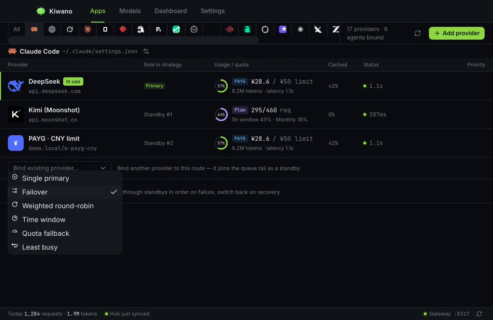

# ストラテジーと上限

すべてのエージェントは、順序づけられた候補キュー — そこに紐付いたプロバイダー —
を通ってルーティングされます。**ストラテジー**は次のリクエストをどの候補が処理する
かを決め、キューの残りはその試行が途中で失敗したときの再実行順序になります。
本ページではストラテジー、支出上限、プラン使用量の読み取り方を説明します。

*Claude Code に紐付いたルート — プライマリ、再実行順に並んだスタンバイ、その上の
ストラテジー選択 UI。*

## 6 つのストラテジー

| ストラテジー | 選ぶもの | 補足 |
| --- | --- | --- |
| `single` | 常にプライマリ。 | 既定値。プロバイダー 1 つ、再実行の末尾なし — ただし、エージェントが自身の支出上限を超えている場合は、`single` を含むどのストラテジーでも拒否されます。 |
| `failover` | 優先順で最初の候補。 | 失敗した試行は同じ順で次の候補に再送されます。失敗したプロバイダーも、次のリクエストでは先頭のままです。 |
| `roundrobin` | 重み付きのローテーション — **セッション単位**。 | 会話はプロバイダーを保持し、すでに支払い済みの上流 prompt cache が引き続きヒットします。新しいセッションは重みで選ばれ、セッションが再割り当てされるのは、固定された候補が使用不能になったときだけです。 |
| `timewindow` | ローカルの `HH:MM` の時間帯（日付をまたぐこともある）が現在を含む候補。 | どれも一致しないときはプライマリにフォールバックします。セッションの固定は `roundrobin` と同じです。 |
| `quota` | 同日の使用量（リクエスト数またはトークン数。使用量の集計から読み取る）がストラテジー設定のしきい値を超えるまではプライマリ、その後はバックアップへ、フェイルオーバー方式で。 | セッションの固定は同じです。切り替えは*次の*会話に適用されます。 |
| `least-busy` | 現在進行中のリクエストが最も少ない候補。 | 実行中のセッションは先に終わらせます（他の固定型ストラテジーと同様）。同数の場合は優先順で決まります。 |

すべてに共通する 2 つの性質があります:

- **会話はプロバイダーを保持します。** 固定型ストラテジー（`roundrobin`、
  `timewindow`、`quota`）では、切り替えは*次の*会話で起こります。すでに走っている
  会話はその場で終わり、プロバイダーがすでに課金した prompt cache を作り直すことは
  ありません。セッションを指定しないリクエストは新たに選ばれます。
- **失敗は返されず、再実行されます。** `single` 以外のどのストラテジーでも、失敗した
  リクエストはエラーとしてエージェントに返されるのではなく、キューの次の候補に対して
  再実行されます。

このスティッキネスはもう一段下にも効きます: プロバイダーのローテーション
キープール（`kiwano keys`）の中でも、会話は開始時の**キー**を使い続けます。
上流の prompt cache はキーが属するアカウントごとに分かれているため、会話の途中で
ローテーションすると、別のアカウントで prefix を input 全額で再構築することになります。
新しいセッションは引き続きプール全体に分散します——その分散こそがプールの目的です——
そして pin はキーより長生きしません: エントリを削除または無効化すれば、セッションは
失敗ではなく生きているエントリに再 pin されます。

プールは**1 つのプロバイダーの下にある複数のアカウント**でかまいません（各エントリの
ラベルはそのためのものです）。そのため台帳はプロバイダーで止まらず、**どのエントリ**が
各リクエストを運んだかを記録します: `kiwano keys list <ID>` はエントリごとの支出を
通貨ごとに報告し、`kiwano logs show` は行の上でエントリを名指しします。

どちらの形にするかは実際の選択で、両者は別の用途のためのものです。**別々に請求される、
または別々に制限される** 2 つのアカウントは、2 つの*プロバイダー*にすべきです——それぞれ
に価格、上限、プロバイダー別ビューの行があり、ストラテジーがその間でフェイルオーバー
できます。プールは**1 つの取り決めの下にある複数のキー**のためのものです——1 つの
アカウントの複数のキーを分散させて 1 本がレート制限に当たらないようにする、あるいは
プロバイダーの行を 1 つに保ったまま負荷だけ分散したいアカウントのために。

## どのプロバイダーが応答したか: レシートヘッダー

ゲートウェイが転送するすべてのレスポンスには、3 つの独自ヘッダーが付きます:

| ヘッダー | 何を示すか |
| --- | --- |
| `X-Kiwano-Provider` | そのリクエストを処理したプロバイダーの id |
| `X-Kiwano-Model` | そのリクエストが計量されたモデル |
| `X-Kiwano-Account` | そのプロバイダーのキープールのどのエントリが運んだか——`primary`、ラベル、または `#<id>`。キーそのものではありません |

`single` では新しい情報はありません。`failover` やスタンバイキューを持つどの
ストラテジーでも、本来なら後でログ画面を掘り返すことになる問い——**この応答、
実際に処理したのは誰か?** ——に、レスポンスの上でその場で答えます。値は
リクエストが計量される帰属と同じものなので、ヘッダーの言うことは台帳の記録そのものです。
ゲートウェイ自身が拒否したリクエスト——支出上限、クライアントキーのポリシー——には
レシートは付きません。処理したものが何もないからです。

## プロバイダーがルートから外れるとき

外れるのは二つだけで、どちらもユーザーが決めたことです。**課金上限**を使い切った、
または `kiwano providers disable` で停止した。どちらもトラフィックから学習したものでは
ありません。失敗したプロバイダーはリトライされ、同じリクエストの中で次の候補へ
フェイルオーバーします。次のリクエストはまたそのプロバイダーに行きます — 何も覚えて
いないので、ベンダーの障害が終わった、あるいはキーを差し替えた直後から、時計を待たずに
再び使われます。
## 支出上限（エージェントの上限）

エージェントは期間ごとの上限 — `day`、`weekly`、`monthly`、`yearly`、`all` — を
持てます。各上限は数値と単位からなります。単位はリクエスト数（`requests`）、
1万トークンのブロック（`wan_tokens`）、または **ISO 通貨コード**です。

通貨の規則は意図的なものです。上限は、そのエージェントのプロバイダーが実際に請求する
通貨で建てられ、あなたの表示設定の通貨では建てられません。プロバイダーが別の通貨で
請求する場合、その支出は Hub の為替レートで換算されてから上限に算入されます — 上限
自体が換算されることはありません。上限に達すると、そのエージェントの新しいリクエスト
は、どのストラテジーでも、明確な理由とともに拒否されます（UI で確認できます）。

## 使用量の数値の出どころ

- **計測された使用量**は、ゲートウェイ自身のリクエスト会計 — リクエストごとの
  トークンとコスト — から読み取り、処理したプロバイダーに帰属させます。
- **プランクォータ**（「プランをどれだけ使ったか」を公表するサブスクリプション）は、
  *プランクエリ*を通じてベンダー自身のエンドポイントから読み取ります。一部の
  カタログエントリはクエリテンプレートを同梱しています（Kimi、Zhipu の個人・
  チーム、MiniMax、ZenMux、OpenCode Go、Volcengine）。結果は 5分間キャッシュされ、
  強制更新できます。プロバイダーがプランとして*課金*されていても、プランクエリに
  対応しているとは限りません — クォータリングが意味を持つのは、クエリテンプレートが
  あってこそです。

## コスト表示と、換算が起きる唯一の場所

コストは各プロバイダーが請求する通貨で記録され、どこでもその通貨で表示されます —
例外は**ダッシュボード**で、ここではあなたの表示通貨設定が適用され、Hub の為替
レートが換算を行います。プロバイダー自身の行に換算後の数値が出ることはありません。
行に ¥ とあれば、そのベンダーは ¥ で請求しています。
